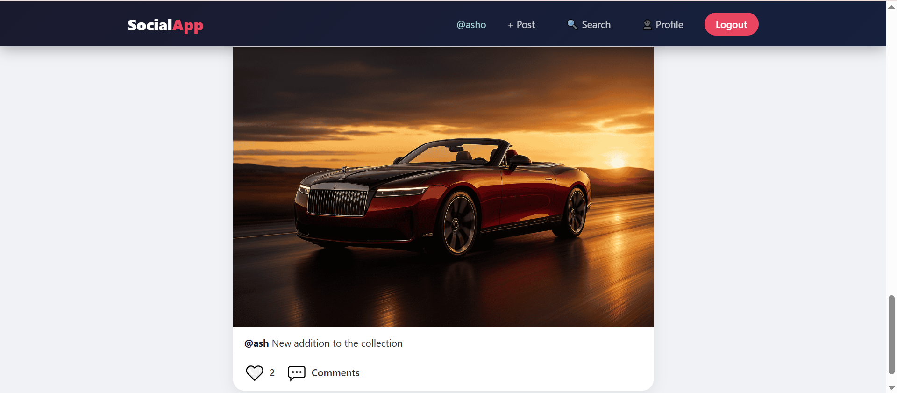

# SocialApp — Social Media Platform

Full-stack social media web app built with Node.js, Express, MongoDB and vanilla JavaScript.



## Features

- User registration and login with JWT authentication
- Password hashing with bcrypt
- Create posts with image uploads
- Like and unlike posts
- Add and delete comments
- Follow and unfollow users
- Search users by name or username
- Profile page with posts, followers and following counts
- Edit profile with picture upload

## Tech Stack

| Layer | Technologies |
|---|---|
| Frontend | HTML5, CSS3, vanilla JavaScript (Fetch API) |
| Backend | Node.js, Express.js, Mongoose |
| Database | MongoDB Atlas |
| Auth | JWT, bcryptjs |
| File uploads | Multer |

## Project Structure

CodeAlpha_SocialMediaPlatform/
├── backend/
│ ├── src/
│ │ ├── config/ # db.js
│ │ ├── models/ # user, post, comment
│ │ ├── controllers/ # auth, user, post, comment
│ │ ├── routes/ # auth, user, post, comment
│ │ └── middleware/ # auth, upload
│ ├── uploads/ # uploaded images (not committed)
│ ├── package.json
│ └── server.js
├── frontend/
│ ├── css/
│ ├── js/ # api, auth, feed, profile, search
│ └── *.html # login, register, feed, profile, search, ...
├── .gitignore
├── demo.png
└── README.md


## Run Locally

**Requirements:** Node.js 18 or newer and a MongoDB Atlas connection string.

```bash
# 1. Clone the repository
git clone https://github.com/ash-1212/CodeAlpha_SocialMediaPlatform.git
cd CodeAlpha_SocialMediaPlatform
```

**Backend**

```bash
cd backend
npm install
```

Create a `.env` file inside `backend/`:

PORT=5000
MONGO_URI=your_mongodb_atlas_connection_string
JWT_SECRET=your_jwt_secret_key


```bash
npm run dev
```

**Frontend**

The frontend is static HTML with no build step. Open `frontend/login.html` in your browser, or use the VS Code Live Server extension. The frontend expects the API at `http://localhost:5000/api`.

## Environment Variables

| Variable | Description |
|---|---|
| PORT | Port for the backend server |
| MONGO_URI | MongoDB Atlas connection string |
| JWT_SECRET | Secret key used to sign JWT tokens |

Never commit your `.env` file.

## Database Schema

**Users:** name, username (unique), email (unique), password (hashed), bio, profilePic, followers [ObjectId], following [ObjectId], createdAt

**Posts:** user (ref User), image, caption, likes [ObjectId], createdAt

**Comments:** post (ref Post), user (ref User), text, createdAt

## API Endpoints

### Auth

| Method | Endpoint | Description |
|---|---|---|
| POST | /api/auth/register | Register new user |
| POST | /api/auth/login | Login user |

### Users

| Method | Endpoint | Description |
|---|---|---|
| GET | /api/users/:username | Get user profile |
| PUT | /api/users/update/me | Update profile |
| POST | /api/users/:id/follow | Follow or unfollow |
| GET | /api/users/search?q= | Search users |
| GET | /api/users/:id/followers | Get followers list |
| GET | /api/users/:id/following | Get following list |

### Posts

| Method | Endpoint | Description |
|---|---|---|
| POST | /api/posts | Create post |
| GET | /api/posts/all | Get all posts |
| GET | /api/posts/feed | Get feed posts |
| GET | /api/posts/:id | Get single post |
| DELETE | /api/posts/:id | Delete post |
| POST | /api/posts/:id/like | Like or unlike |

### Comments

| Method | Endpoint | Description |
|---|---|---|
| POST | /api/comments/:postId | Add comment |
| GET | /api/comments/:postId | Get comments |
| DELETE | /api/comments/:id | Delete comment |

## Notes

- Uploaded images are stored locally in `backend/uploads` and are not included in the repository.
- The project runs locally and has not been deployed.

## Future Improvements

- Real-time notifications with Socket.io
- Direct messaging between users
- Stories feature
- Post editing
- Email verification
- Deployment (Render and Vercel)

## Author

**Ayesha Nazish**
Built during the CodeAlpha Full Stack Development Internship (Task 2).
[GitHub](https://github.com/ash-1212) · [LinkedIn](https://www.linkedin.com/in/ayeshanazish-452048274)
